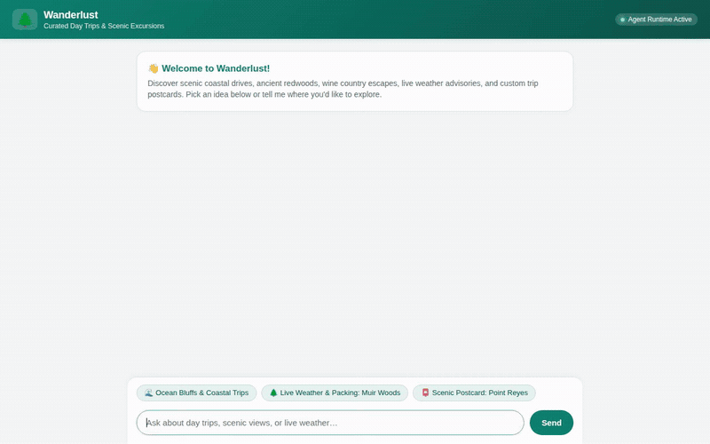

# 🌲 Wanderlust — Curated Travel & Day-Trip Planner

An intelligent conversational travel concierge built with Google's **Agent Development Kit (ADK)** and powered by **Gemini 3.8 Flash**. Wanderlust curates personalized day-trips, checks real-time weather conditions, renders vintage scenic travel postcards, and creates cinematic short trip videos.



---

## 🌟 What the Agent Does

Wanderlust helps travelers plan and explore excursions around Northern California and beyond:
- **Curated Destination Discovery**: Queries real spots from a Firestore catalog matching traveler vibes (*coastal*, *redwoods*, *wine country*, *culinary*).
- **Persistent Long-Term Memory**: Remembers traveler preferences, dietary constraints, favorite vibes, and past trips across conversations via Vertex AI Memory Bank.
- **Live Weather & Packing Advisories**: Fetches real-time temperature, wind, humidity, and forecast conditions for any destination.
- **Scenic Postcard Generation**: Creates customized vintage travel posters using Vertex AI Imagen and automatically uploads them to Google Cloud Storage.
- **Cinematic Video Generation**: Produces scenic video clips of destinations using Google's Omni model (`gemini-omni-flash-preview`) in the global region.
- **Local Points of Interest**: Discovers trailheads, historic sights, and landmarks near any destination.
- **Secure Code Execution**: Employs an isolated Agent Engine sandbox to run Python calculations for mileage, route pacing, and trip budgeting.

---

## ☁️ Google Cloud Services & Tools Wired Up

The agent implements and connects the following services in `app/agent.py` and `app/travel_tools.py`:

| Service / Tool | Implementation Detail | Purpose |
| :--- | :--- | :--- |
| **Vertex AI Memory Bank** | `PreloadMemoryTool` & `generate_memories_callback` | Cross-session long-term memory for traveler preferences and past trips |
| **Cloud Firestore** | `get_all_destinations`, `search_destinations`, `save_destination` | Structured database catalog of curated day-trip spots, vibes, and drive times |
| **Cloud Storage** | `google.cloud.storage` bucket uploads | Public hosting for generated trip postcards (`images/`) and video clips (`videos/`) |
| **Vertex AI Imagen** | `create_scenic_postcard` (`imagen-3.0-generate-002`) | Generates vintage scenic travel artwork, saved to session artifacts & Cloud Storage |
| **Google Omni Model** | `create_scenic_video` (`gemini-omni-flash-preview`) | Generates destination video clips via the Interactions API in the global region |
| **Agent Engine Code Sandbox** | `AgentEngineSandboxCodeExecutor` | Executes Python code for budget calculations, fuel estimates, and route pacing |
| **Live Weather API** | `fetch_live_weather` (Open-Meteo) | Real-time weather conditions and outdoor excursion packing recommendations |
| **Local Attractions Tool** | `find_nearby_points_of_interest` (Wikipedia GeoSearch) | Geolocated discovery of trailheads, viewpoints, and historic landmarks |
| **A2UI Mini-Renderer** | Custom web chat interface | Renders text, markdown images, and A2UI cards/columns/rows natively |

> [!NOTE]
> **Planned / Stretch Goals (Not Yet Implemented):**
> - Direct Google Maps live navigation routing (currently estimates distance/drive-time via catalog & code sandbox).
> - PDF itinerary export.

---

## 🏗️ Project Architecture

```
wanderlust-agent/
├── app/
│   ├── agent.py                 # Root ADK agent definition, model, tools, callbacks
│   ├── travel_tools.py          # Weather, Imagen, Omni video, and nearby attraction tools
│   ├── firestore_service.py     # Firestore database connection & destination seed catalog
│   ├── fast_api_app.py          # A2A / Reasoning Engine FastAPI adapter
│   └── app_utils/               # A2A protocol and reasoning engine runtime helpers
├── frontend/
│   ├── main.py                  # Lightweight FastAPI chat & A2A proxy server
│   ├── requirements.txt         # Frontend dependencies (fastapi, uvicorn, httpx)
│   └── static/
│       └── index.html           # Wanderlust branded chat UI with A2UI & image rendering
├── agents-cli-manifest.yaml     # ADK agent deployment manifest
├── demo.gif                     # Demo recording (Gemini World Tour frame)
└── pyproject.toml               # Python dependencies and agent package settings
```

---

## 🚀 Running the Project Locally

### Prerequisites
- Python 3.11+
- [uv](https://docs.astral.sh/uv/) package manager
- Google Cloud SDK (`gcloud`) authenticated to your Google Cloud project

```bash
gcloud auth application-default login
```

### 1. Run the Agent Playground
Launch the ADK development web UI with memory bank integration:

```bash
cd wanderlust-agent
uv run adk web . --port 8000 --reload_agents
```

### 2. Run the Custom Branded Frontend
In a separate terminal, launch the FastAPI proxy server and chat UI:

```bash
cd wanderlust-agent/frontend
pip install -r requirements.txt
export AGENT_ENGINE_RESOURCE_NAME="<your-agent-engine-resource-name>"
export AGENT_DIRECTORY="app"
python main.py
```

Open your browser to the local address output in your terminal to interact with Wanderlust.

---

## 🚢 Deploying to Google Cloud

### Deploy Agent to Agent Runtime

```bash
cd wanderlust-agent
uv run agents-cli deploy --project <your-gcp-project-id>
```

### Deploy Frontend to Cloud Run

```bash
cd wanderlust-agent/frontend
gcloud run deploy wanderlust-frontend \
  --source . \
  --region us-east1 \
  --allow-unauthenticated \
  --set-env-vars AGENT_ENGINE_RESOURCE_NAME="<your-agent-engine-resource-name>",AGENT_DIRECTORY="app"
```
